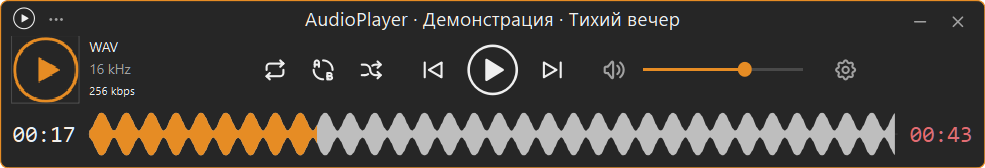

<p align="center"></p>
<h1 align="center">AudioPlayer</h1>
<p align="center">Компактный плеер для Windows со звуковой волной вместо обычного таймлайна.</p>
<p align="center"><a href="README.en.md">English</a> · <a href="https://github.com/Frommer-droid/AudioPlayer/releases/latest">Скачать</a></p>



AudioPlayer воспроизводит локальную музыку, показывает обложку и теги и позволяет
перематывать трек по звуковой волне. Интерфейс выполнен в графитово-оранжевом стиле.

## Установка

Скачайте установщик из [последнего выпуска](https://github.com/Frommer-droid/AudioPlayer/releases/latest),
установите и запустите AudioPlayer. Требуется Windows x64; сборка проверена на Windows 11.
Отдельно устанавливать Python или FFmpeg для готовой программы не нужно.

Нажмите левой кнопкой на обложку и выберите музыку. Клик по прошедшему времени
показывает/скрывает плейлист. Клик по длительности открывает текст песни из тегов;
повторный клик скрывает панель.

## Управление

- Круглая кнопка: левый клик — воспроизведение/пауза, правый — остановка.
- Клик по волне — переход к нужному моменту. Колесо на себя — вперёд, от себя — назад.
- Вне волны колесо регулирует громкость. Шаг перемотки настраивается через шестерёнку.
- Кнопка «+» создаёт вкладку плейлиста, правый клик закрывает её. Поиск работает по названию. Треки остаются только в текущем сеансе; названия вкладок сохраняются.
- В Проводнике можно выделить сразу много треков и нажать «Воспроизвести»: весь список попадёт в один плеер без искусственного ограничения количества файлов.
- Заголовки №, название, формат и время сортируют плейлист; повторный клик меняет направление. Ширина столбцов подбирается автоматически.
- Красное время справа от волны показывает, сколько осталось до конца. Правый клик переключает на полную длительность. Каждый новый трек начинает с остатка.
- Диалоги открытия и добавления музыки запоминают последнюю выбранную папку между запусками.
- Тексты песен из тегов имеют настройку размера шрифта; кнопка появляется при наличии текста.
- Если в тегах нет обложки, плеер берёт изображение из папки трека: cover, folder, front или первое подходящее по имени.
- Режимы: остановка после трека → повтор трека → плейлист один раз → плейлист по кругу. Доступны A–B и случайный порядок.
- Стрелки перематывают на ±5 секунд; Home/End меняют треки, пробел переключает паузу.
- Клик по логотипу закрепляет окно поверх остальных. Размер и положение окна сохраняются.
- Значок в трее возвращает окно; меню трея позволяет управлять воспроизведением и выйти.
- «Убрать» и «Убрать всё» меняют очередь, музыкальные файлы остаются на диске.

## Форматы

MP3, FLAC, WAV, OGG/OGA, Opus, M4A (AAC и ALAC), AAC, WMA, AIFF/AIF,
APE и WavPack (WV). Повреждённые файлы и DRM-защита не поддерживаются.
Волна строится в фоновом потоке и кешируется; первый анализ зависит от длины файла.

## Запуск из исходников

Нужен Python 3.12 x64. В PowerShell в папке проекта:

```powershell
py -3.12 -m venv .venv
.\.venv\Scripts\python.exe -m pip install -r requirements.txt
.\AudioPlayer-run.cmd
```

Сборка описана в [BUILD.md](BUILD.md). Собственный код — [MIT](LICENSE),
сторонние компоненты — по [их лицензиям](THIRD_PARTY_NOTICES.md).
